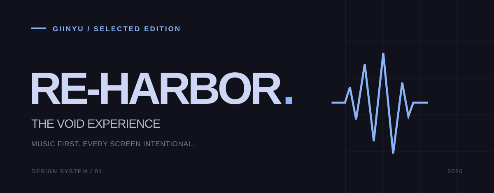
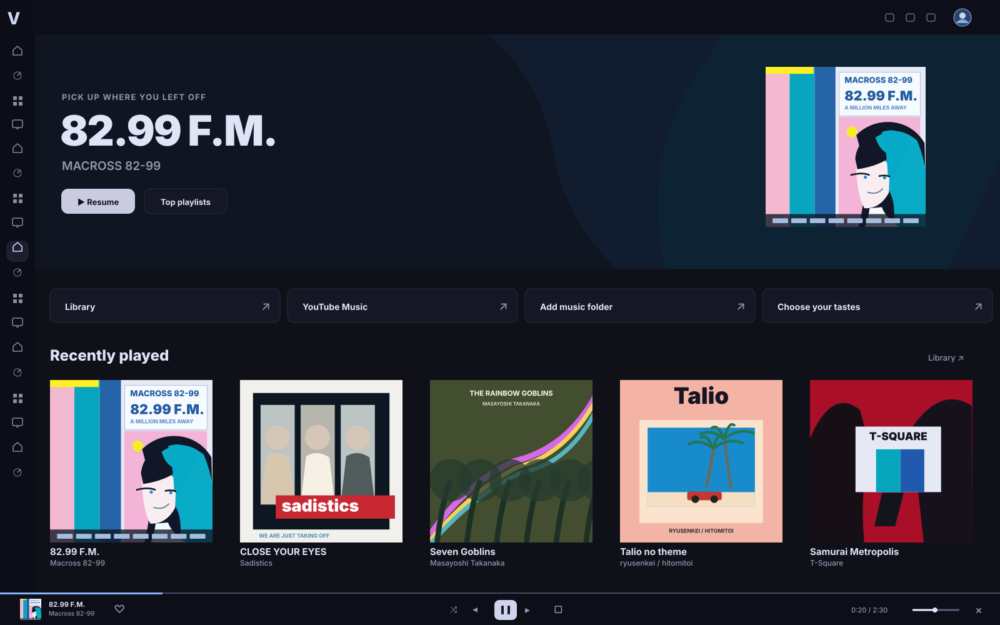
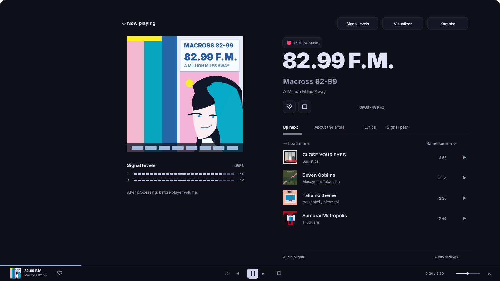
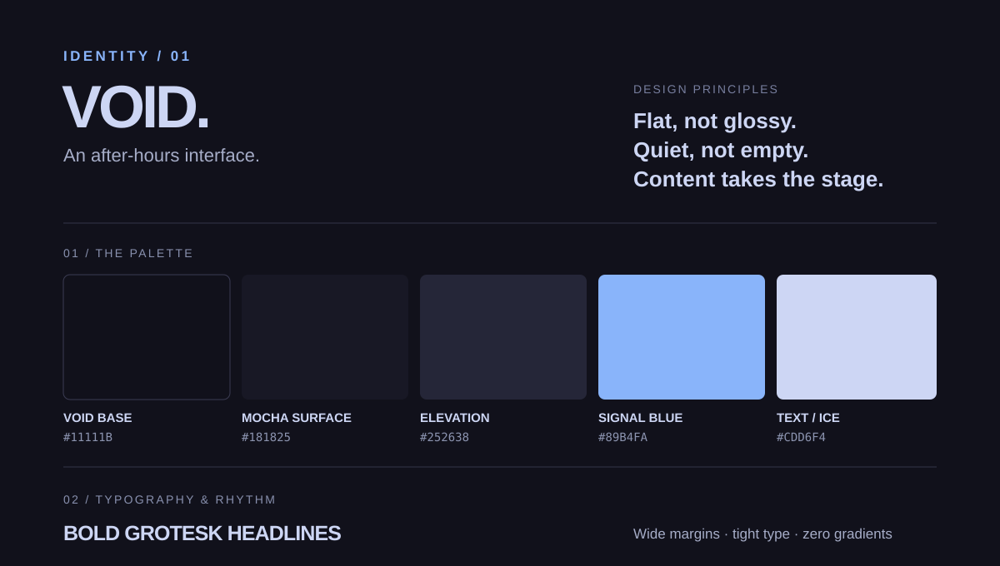
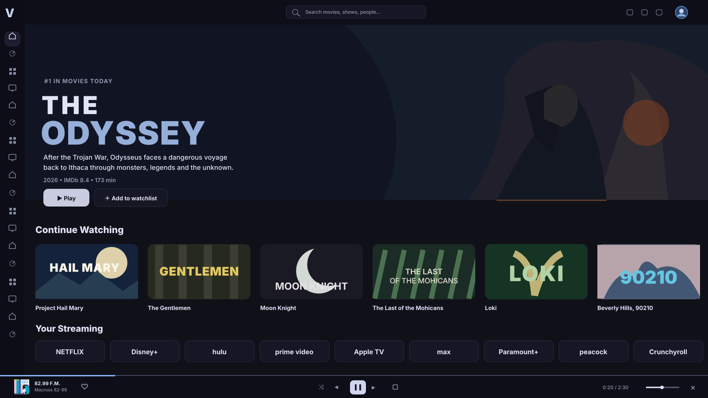

<div align="center">



<br/>

**A music-first, VOID-styled take on Harbor.**

A personal edition by **[giinyu](https://github.com/G1NYU)** — immersive listening, considered interfaces, and useful connections between media and tracking.

<br/>

[**Experience**](#01--the-listening-room) &nbsp;&nbsp;·&nbsp;&nbsp; [**VOID identity**](#02--the-void-identity) &nbsp;&nbsp;·&nbsp;&nbsp; [**Features**](#03--beyond-music) &nbsp;&nbsp;·&nbsp;&nbsp; [**Install**](#05--install) &nbsp;&nbsp;·&nbsp;&nbsp; [**Build**](#06--under-the-hood)

</div>

<br/><br/>

## RE-Harbor

**Music deserves more than a tab.**

RE-Harbor is a custom [Harbor](https://github.com/Harborofficial/Harbor) desktop fork, shaped around the **VOID** visual language: near-black purple surfaces, confident typography, restrained blue accents, and generous room for the artwork.

It keeps Harbor's wider media capabilities while giving music its own deliberate environment — from the first record on the home screen to an expanded, full-window Now Playing view.

<sub>Independent, experimental edition. Not an official Harbor release or an official Refract client.</sub>

<br/><br/>

## 01 / The listening room

<p align="center">
  
  <br/><sub>THE LISTENING ROOM — vector study of personal context, album artwork, listening shortcuts and recent records.</sub>
</p>

<br/>

An editorial music home rather than a generic catalog page. The current record anchors the experience; recent listens and service/library entry points remain close. Large artwork, tight information hierarchy and a fixed palette prevent the interface from competing with the music.

| Listening | Playback & discovery |
| :-- | :-- |
| Full-width persistent music dock | Local library and connected music sources |
| Expanded full-window Now Playing | Album, artist and track-focused views |
| Queue / Up Next and playback controls | Listening history and recently played |
| Lyrics, signal-level and visualizer interfaces | Optional Last.fm scrobbling and now-playing integration |

<sub>Playback, visualizer, karaoke and provider-dependent capabilities may vary by source and configuration. This is a working preview, not a guarantee of every provider's availability.</sub>

<br/>

<p align="center">
  
  <br/><sub>NOW PLAYING — a vector interpretation of the immersive playback screen.</sub>
</p>

<br/><br/>


<sub>Interface illustrations are original SVG mockups based on the VOID preview, not live screenshots; visible functionality may differ by build and provider.</sub>

## 02 / The VOID identity

<p align="center">
  
</p>

<br/>

**The rules are simple:** flat rather than glossy; deep night-purple rather than saturated black; blue as a signal, never decoration; strong type; content-sized negative space. No unnecessary gradients, glass, neon pink, or artwork-derived color wash across the chrome.

| Token | Hex | Role |
| :-- | :-- | :-- |
| **VOID Base** | `#11111B` | App canvas and immersive backgrounds |
| **Mocha Surface** | `#181825` | Panels, navigation and elevated layouts |
| **Elevation** | `#252638` | Separators, controls and quiet outlines |
| **Signal Blue** | `#89B4FA` | Intentional focus, active state and interaction |
| **Ice Text** | `#CDD6F4` | Headlines and primary reading contrast |
| **Muted Text** | `#A6ADC8` | Secondary labels, metadata and captions |

**Type & composition.** Heavy, compact grotesk headlines; clear sans-serif interface copy; broad margins; measured repetition. Posters and covers are the color — the product chrome stays neutral.

[Full brand notes and usage rules](docs/VOID-BRAND.md)

<br/><br/>

## 03 / Beyond music

<p align="center">
  
  <br/><sub>ONE VISUAL LANGUAGE — vector interpretation of VOID across films, series and the listening room.</sub>
</p>

<br/>

Music is the focus, not the limit. The wider Harbor experience retains movies, series, anime, collections, streaming discovery, a native player, addon support and home-server integrations inherited from upstream. VOID extends the visual vocabulary across those screens with reduced chrome, tuned sidebar hierarchy, cleaner hero treatment and more legible artwork overlays.

The fork also includes interface and quality-of-life work around responsive music layouts, navigation, top-bar clearance, track lists and the full-width dock. These additions should remain fast and usable rather than accumulating decorative effects.

<br/><br/>

## 04 / Refract, natively

**What you watch can follow you.** RE-Harbor includes the native *outbound* [Refract](https://getrefract.app/) tracker integration contributed to upstream [Harbor PR #103](https://github.com/Harborofficial/Harbor/pull/103).

- Sign in through **Settings → Trackers → Refract** using your own API key.
- Log movie and episode watches manually or as playback progresses, with configurable time/percentage thresholds.
- Map Harbor watchlist additions and removals to Refract's **Plan to Watch** membership.
- Retry queued events and protect against duplicate history records.

**Scope matters:** Refract → Harbor reverse sync, bulk importing and non-video media types are **not included**. This optional integration uses Harbor's secret storage; never commit an API key. [Implementation notes](https://github.com/G1NYU/RE-Harbor/blob/feature/void-refract-2026-11-installer/docs/refract.md).

<br/><br/>

## 05 / Install

**Windows x64 · preview installer**

The current standalone VOID + Refract setup was produced by a successful [GitHub Actions build](https://github.com/G1NYU/RE-Harbor/actions/runs/44761502098). Open its **Artifacts** section, download `harbor-void-refract-setup-windows-x64`, extract the ZIP, then run the setup executable.

The installer is **unsigned** and may prompt Windows SmartScreen. It installs alongside regular Harbor, uses a separate preview app identifier, and does not replace the official installation. GitHub Actions artifacts expire; this link is to a specific tested snapshot, **not** a rolling latest release or an upstream-synced build.

For upstream Harbor releases or other platforms, visit [Harborofficial/Harbor](https://github.com/Harborofficial/Harbor).

<br/><br/>

## 06 / Under the hood

| Layer | Technologies / responsibility |
| :-- | :-- |
| Interface | React, TypeScript, Vite, CSS |
| Desktop shell | Tauri 2 and Rust |
| Playback | Native libmpv with supporting media tools |
| Integrations | Stremio addon protocol, music connectors, Refract, optional Last.fm |
| Validation | TypeScript, Node tests, Windows builds, UI regression checks |
| Packaging | Windows x64 portable preview and isolated NSIS setup |

**Source layout**

```text
src/                  React UI, media views and components
src-tauri/            Rust desktop shell and music backend
src/components/music/ Music transport, queue and player UI
src/views/music/      Listening room and music detail views
docs/                 Feature, tracker and brand notes
installer/void/       Isolated Windows installer tooling
.github/workflows/    Build and validation automation
```

**Development** — the VOID + Refract preview lives on [`feature/void-refract-2026-11-installer`](https://github.com/G1NYU/RE-Harbor/tree/feature/void-refract-2026-11-installer), while `beta-branch` remains the fork's default branch. Building the default branch alone does **not** recreate this custom edition.

```bash
git clone https://github.com/G1NYU/RE-Harbor.git
cd RE-Harbor
git checkout feature/void-refract-2026-11-installer
corepack enable
pnpm install
pnpm run setup
pnpm run build:desktop
```

Building the desktop executable also requires the platform-specific [Tauri prerequisites](https://v2.tauri.app/start/prerequisites/) and native toolchain. On a configured Windows development machine, use `pnpm tauri build`; the **isolated preview installer** has its own workflow and packaging notes under [`installer/void/`](https://github.com/G1NYU/RE-Harbor/blob/feature/void-refract-2026-11-installer/installer/void/README.md). Those two build paths are not interchangeable.

For checks, run `pnpm typecheck` and `pnpm test`; provider playback and account authorization still require real-device testing.

<br/><br/>

## 07 / Credits & responsibility

RE-Harbor is a personal fork and visual direction by **[giinyu](https://github.com/G1NYU)**. It builds on the work of the [Harbor maintainers and contributors](https://github.com/Harborofficial/Harbor/graphs/contributors), with native Refract work also contributed upstream. **Harbor is the original project; VOID is this fork's custom presentation.**

Like Harbor, this project is a client/software project: it does **not** host, provide or bundle media streams or content addons. Use only your own media and sources you are authorized to access. The code is distributed under the repository's [MIT license](LICENSE). No official affiliation with music providers or tracking services is implied.

<br/><br/>

<div align="center">

**Built for the hours after dark.**

[Harbor upstream](https://github.com/Harborofficial/Harbor) &nbsp;&nbsp;·&nbsp;&nbsp; [VOID source branch](https://github.com/G1NYU/RE-Harbor/tree/feature/void-refract-2026-11-installer) &nbsp;&nbsp;·&nbsp;&nbsp; [Issues](https://github.com/G1NYU/RE-Harbor/issues)

<br/>

**giinyu.**

</div>