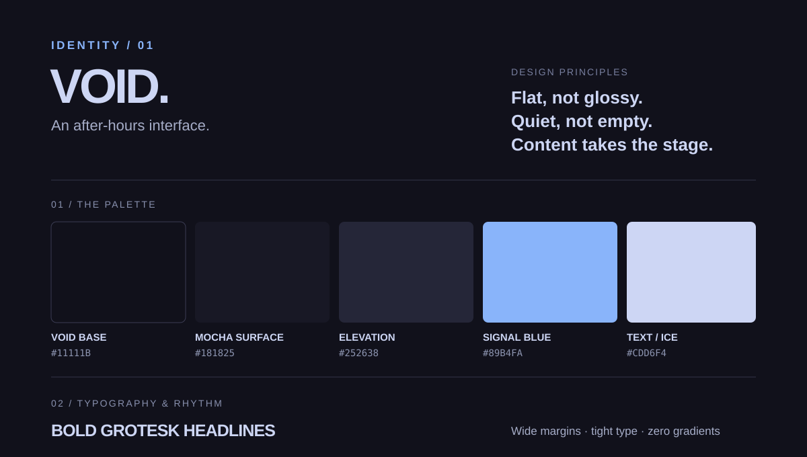

# VOID / brand system

An editorial design reference for the **RE-Harbor** interface by **giinyu**. The brand is intentionally quieter than the music and media displayed inside it.

## Palette

| Token | Value | Intended use |
| --- | --- | --- |
| Void base | `#11111B` | Main canvas and immersive surfaces |
| Mocha surface | `#181825` | Elevated region/background |
| Elevation | `#252638` | Borders, control outlines, separators |
| Signal blue | `#89B4FA` | Active controls, keyboard focus, selective emphasis |
| Ice text | `#CDD6F4` | Main title and UI text |
| Muted text | `#A6ADC8` | Supporting labels |

The design is *Catppuccin Mocha-adjacent*, not a claim that the source code exclusively uses these exact tokens. Artwork can carry any color; UI chrome should not sample it into broad color washes.

## Typography

- Use a sturdy sans/grotesk for headings; keep tracking compact and line-height intentional.
- Prefer clean interface text over decorative typography, with metadata clearly subordinate.
- Preserve legibility over detailed artwork through subtle flat overlays rather than noisy effects.
- Prefer typographic hierarchy to colored badges, outlines or excess separators.

## Layout

- **Negative space is an element**, not wasted canvas. Let hero images, covers and titles breathe.
- Use wide but disciplined content rails. The expanded Now Playing page should read as a distinct environment rather than a modal enlarged from the player bar.
- Keep the dock edge-to-edge without obstructing account menus, transport actions, toolbars or content.
- Use few active states: one highlighted destination, one clear action and quiet inactive controls.
- Keep desktop geometry, responsiveness and motion budgets in mind. Avoid gradients, uncontrolled animated backdrops, poster remounts and runtime artwork-color extraction in chrome.

## Imagery

Use screenshots of the actual build, with no fabricated playback indicators. Capture at stable UI states and show the listening room, expanded Now Playing, and wider media browsing. Favor one strong composition per section and preserve a generous margin above and below each image.

## Language

Use short, assured labels and explain technical limits precisely. Avoid claims of universal music-service availability, always-working visualizers, signed releases, or bi-directional Refract sync unless independently verified.

## Attribution

VOID is the custom visual identity of the personal RE-Harbor fork. Harbor is the original MIT-licensed project. Do not remove upstream attribution or the repository license when reusing the design system.